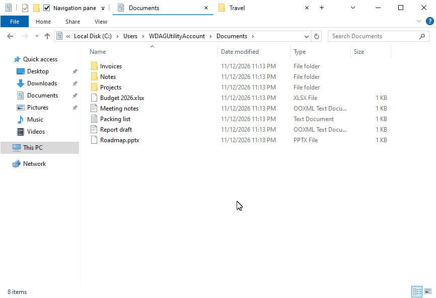
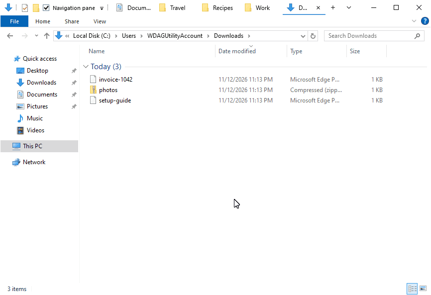
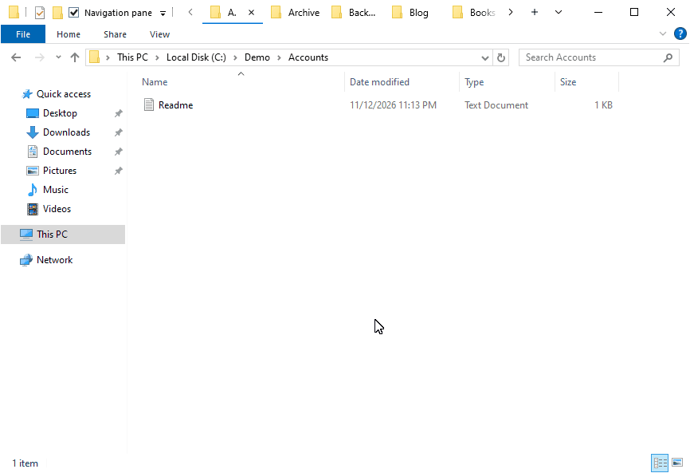
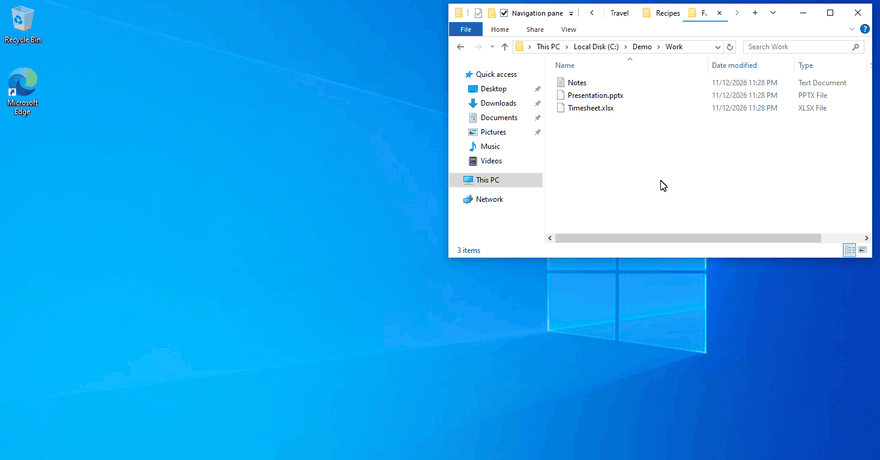
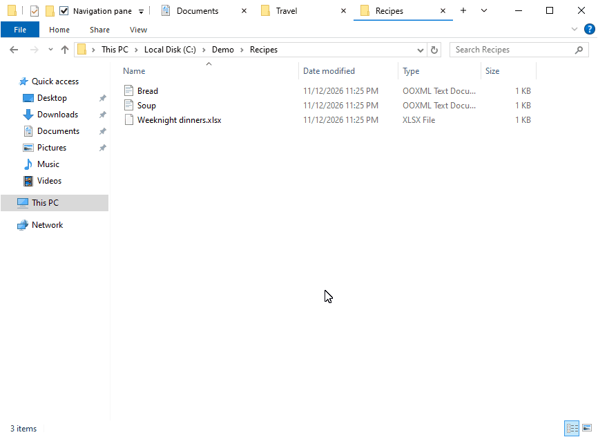
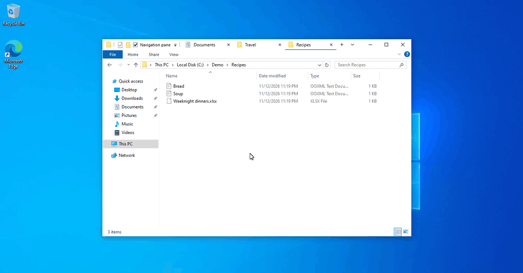

<div align="center">

# Explorer MVP

Tabs in the title bar of Windows 10 File Explorer.

[%20x64-0078D4)](#requirements)
[](LICENSE)
[](https://github.com/SirBarnaby/win10explorer-kex/releases/latest)

[Features](#features) · [See it in action](#see-it-in-action) · [Install](#install) · [Options and shortcuts](#options-and-shortcuts) · [Optional extra: touchpad snapping](#optional-extra-touchpad-snapping) · [Requirements](#requirements) · [Common questions](#common-questions) · [Building](#building-from-source) · [Licence](#licence)

</div>

Explorer MVP adds folder tabs to the real File Explorer window on Windows 10. The tabs sit in the title bar, next to Explorer's own Quick Access Toolbar, and use the window's own colours. The Ribbon, address bar, search box and folder view stay Explorer's own.

## Features

- **Tabs in the title bar.** Folder tabs share Explorer's title bar; a narrow window gets a tab row above the address bar instead.
- **Fast switching.** The tab you click is highlighted in about 6 ms, and the folder view is back in place in about 180 ms.
- **Many tabs.** Up to 500 tabs per window; tabs shrink to 76 px, then the strip scrolls with the wheel, the touchpad or its arrows.
- **Reorder by dragging.** Drag a tab along the strip and the others slide aside.
- **Move tabs between windows.** Drag a tab out to open it in its own window, or drop it on another Explorer window.
- **Reopen closed tabs.** The tab you just closed can be brought back.
- **Session restore.** Explorer can reopen the tabs you had the last time.
- **Motion.** Tabs slide when they open, close or move, and stay smooth while a folder loads; one checkbox turns it off.
- **Native colours.** Tab text follows light, dark and accent-coloured title bars, high contrast, and DWMBlurGlass title colours.
- **Screen readers.** Tabs, close buttons and off-screen tabs are announced through Windows' own accessibility interface.
- **No background cost.** No tray icon, no timers, no polling; the hidden starter uses about 3.5 MB of memory and no measurable CPU while idle.
- **Per-user install.** One 2.2 MB setup file, no administrator rights, no Windows system file replaced.

## See it in action

**Open, switch and close tabs**



**Reorder tabs** by dragging along the strip



**Many tabs** scroll with the mouse wheel



**Move a tab** to its own window or into another one



**Options** for each feature



## Install

1. Download [`ExplorerMvpSetup.exe`](https://github.com/SirBarnaby/win10explorer-kex/releases/latest/download/ExplorerMvpSetup.exe) from the [latest release](https://github.com/SirBarnaby/win10explorer-kex/releases/latest).
2. Double-click it. The file is not code-signed, so SmartScreen may show "Windows protected your PC". Select **More info**, then **Run anyway**.
3. Setup says what this PC gets: tabs in the title bar, tabs in a row under the Ribbon, or snapping only. Choose tabs and/or touchpad snapping and select **Install / Update**.
4. Open a File Explorer window. Windows that were already open get tabs too; nothing needs restarting.

To update, run the newer setup the same way. Your settings and open tabs are kept.

To remove it, use **Explorer MVP → Change or remove** in the Start menu, or **Apps & features** in Windows Settings. Setup puts your previous touchpad gestures back. If Explorer still has the add-on loaded, setup asks you to close your folder windows and try again; it never closes Explorer itself.

Scripted install:

```
ExplorerMvpSetup.exe --install [--tabs | --no-tabs] [--gestures | --no-gestures]
ExplorerMvpSetup.exe --uninstall
```

## Options and shortcuts

Open **Explorer MVP → Options** from the Start menu, or right-click a tab and select **Options**.

| Option | What it does |
|---|---|
| Explorer title-bar tabs | Turns tabs on or off. Turning them off keeps the current folder open and saves the tabs. |
| Restore tabs when starting Explorer | Reopens the tabs from the last session. |
| Animate tabs | Tabs slide when they open, close or move. "Show animations in Windows" in Ease of Access also turns this off. |

| Shortcut | Action |
|---|---|
| Ctrl+T | New tab |
| Ctrl+W, or middle-click a tab | Close tab |
| Ctrl+Shift+T | Reopen closed tab |
| Ctrl+Tab, Ctrl+PgDn | Next tab |
| Ctrl+Shift+Tab, Ctrl+PgUp | Previous tab |
| Ctrl+Shift+PgDn / PgUp | Move the tab right / left |
| Ctrl+1 to 8 | Select that tab |
| Ctrl+9 | Select the last tab |
| Win+E, Ctrl+N | Open a separate Explorer window, as before |

Right-click a tab for **Duplicate tab**, **Move tab to new window** and **Close tab**.

## Optional extra: touchpad snapping

The setup also carries a separate extra that is not part of the tabs: three-finger touchpad swipes that snap the active window. Turn it on with the **Touchpad snap gestures** checkbox in setup or in Options. Turning it off again puts back the three-finger gestures you had before.



The recording uses Ctrl+Alt+Win+Arrow, the shortcut the swipes are bound to.

| Three-finger swipe | Result |
|---|---|
| Left / Right | Snap to that half of the screen |
| Up / Down on a snapped window | Top or bottom corner of that side |
| Up again at a top corner | Maximize; Down returns to the corner |
| Up / Down on a floating window | Nothing changes |

- Swipes never minimize or centre a window.
- Drag Windows' divider between two snapped windows and later snaps on that display reuse the split.
- It needs a Precision Touchpad. Without one, **Optional keyboard shortcuts** in Options makes Ctrl+Alt+Win+Arrow do the same; Win+Arrow keeps its Windows behaviour.
- **Restore previous gestures** in Options puts back the three-finger gestures you had before.
- It runs as its own hidden program, `NativeSnap.exe`, only while it is turned on.

## Requirements

- Windows 10 version 22H2, 64-bit, build 19045. It does not install on other Windows versions, including Windows 11.
- For tabs in the title bar, `UIRibbon.dll` and `uxtheme.dll` in `C:\Windows\System32` must be exactly the versions this release was tested with. Setup checks this and tells you the result before installing.
- If only `uxtheme.dll` differs, tabs go in a row under the Ribbon. If `UIRibbon.dll` differs, tabs stay off and only touchpad snapping is offered.
- No administrator rights. It installs for the current Windows account, in `%LOCALAPPDATA%\Programs\Explorer MVP`.

Disk use is about 4 MB per installed version. Earlier versions are kept, at about 2 MB each, until you uninstall.

## Common questions

**How does it work?**
A small hidden program, `ExplorerMvpHost.exe`, starts when you sign in and loads `ExplorerTabs.dll` into File Explorer when a folder window opens. Inside Explorer, the add-on creates the tab strip as a child of the Explorer window. To make room for it, it redirects one internal callback in `UIRibbon.dll` and hooks two drawing functions in `uxtheme.dll` (`BeginBufferedPaint` and `EndBufferedPaint`). These changes are made in memory only; no file in the Windows folder is modified.

**What happens after a Windows update?**
Most monthly updates leave the two files alone, and the tabs keep working. If an update replaces `UIRibbon.dll` or `uxtheme.dll`, the add-on notices that the file is no longer the tested one and turns the title-bar tabs off, or moves them to the row under the Ribbon. Explorer then looks as it does without the add-on. Tabs come back with a release tested against the new files.

**Why does SmartScreen warn about the setup?**
The setup is not code-signed. Only run a copy downloaded from this repository's releases, or one you built yourself. Setup checks its own contents before installing and stops if the file is damaged.

**Does each tab keep its folder loaded?**
No. A window has one folder view, as in Windows 10 itself. Switching to a tab loads its folder again, and then puts back its scroll position and selection.

**Does it change Explorer's Ribbon or Quick Access Toolbar?**
No. They are the real ones and stay usable. Your Ribbon and toolbar settings are left alone.

**Is there a tray icon?**
No. Use the Start menu entry or right-click a tab to reach Options.

**Does it work with QTTabBar or other Explorer extensions?**
Other extensions are left alone. If the QTTabBar tab bar from this project's first version is present, it is hidden while the new tabs are on.

**What are the known limits?**
- Tested on one PC. Several monitors, mixed display scaling, sleep and resume, and physical touchpad hardware have not been tested systematically.
- Dragging a tab out to its own window can occasionally drop it back on its own strip. Drag it out again.
- After a graphics driver reset, the strip may stay empty until the pointer moves over it. If drawing keeps failing, the window goes back to Windows' own title bar.
- Uninstalling may need you to close open folder windows first, or to sign out once so the touchpad gestures are put back.

## Building from source

You need Visual Studio 2022 C++ Build Tools, a Windows 10 SDK and CMake 3.24 or later.

```powershell
.\Build-Native.ps1 -BuildDirectory .\build-mvp
```

The binaries land in `build-mvp\Release`. See [docs/building.md](docs/building.md) for the tests and for packaging the setup. Changes per release are in [CHANGELOG.md](CHANGELOG.md).

## Licence

Explorer MVP is free software under the [GNU General Public License, version 3 or later](LICENSE).

It includes:

- [MinHook](https://github.com/TsudaKageyu/minhook) 1.3.4 by Tsuda Kageyu, BSD 2-Clause licence, with a local change described in `native/vendor/minhook/PROVENANCE.txt`.
- Reference source from [StExBar](https://github.com/stefankueng/tools) by Stefan Küng, GPL version 2 or later; parts of the Explorer integration are adapted from it.

Explorer MVP is not affiliated with Microsoft. It is an Explorer add-on, not a backport of the Windows 11 tabs.
