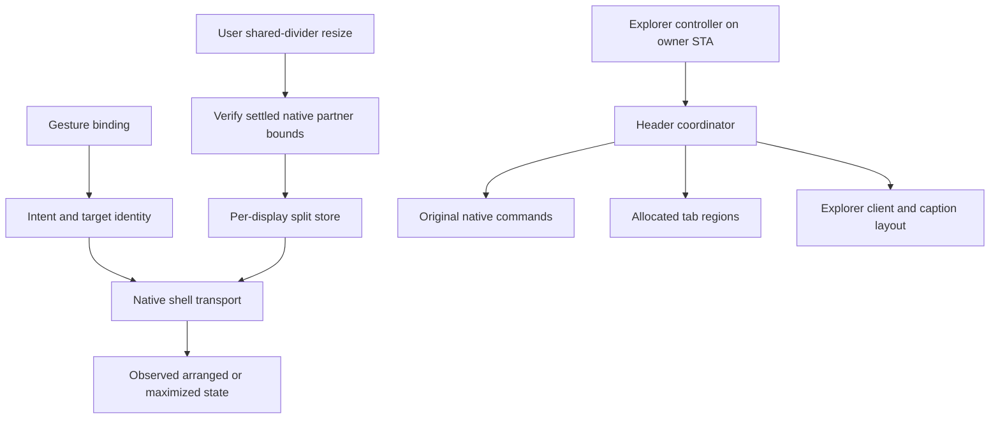
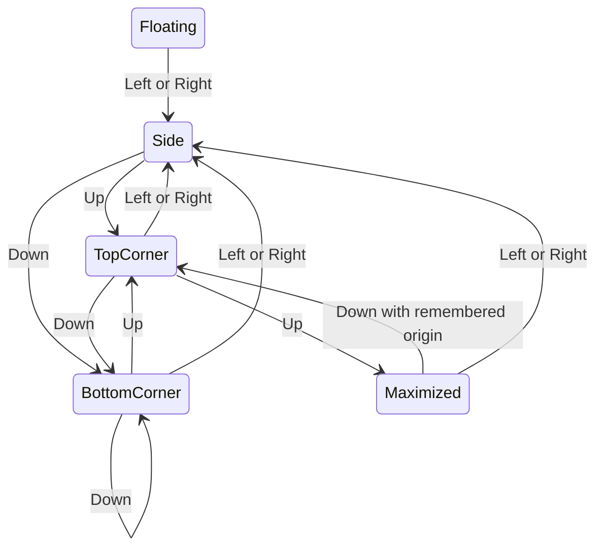

# Native Explorer Headers and Snapping - Plan

The header implementation planning is superseded by [Native Explorer Header Rebuild - Plan](2026-11-04-2233-fix-native-explorer-header-plan.md). That follow-up preserves R1-R14 and the existing snapping contract while replacing the header work with U10-U15 and stronger native input, material and contextual-content acceptance. Earlier delivery statements below describe their original verification phase.

## 4 November delivery scope

The user's latest instruction confines runtime work to Sandbox and excludes Computer Use. Source implementation, review and the local package are complete within that scope; the desktop installation is unchanged. The guest reports base build 19041 while all six relevant Windows components match the host's 19045 images byte for byte. A lab-only attach-time version-query adaptation is documented in `docs/header-acceptance.md`; production compatibility checks are unchanged. Physical gestures, hardware/theme/DPI breadth, desktop cutover and public distribution are not claimed. The final acceptance record supersedes earlier red development evidence only for the exact recorded binaries.

## Goal Capsule

- **Objective:** Explorer's controls remain usable beside folder tabs, and touchpad window arrangement behaves like Windows Snap while retaining the user's chosen split.
- **Means:** Replace caption clipping with allocated Explorer header layout; preserve native shell arrangement when applying gesture transitions and remembered geometry (KTD1-KTD5).
- **Authority:** The 3 November request adds native shared resizing, remembered percentages and top-corner Up-to-maximize to the earlier header contract. The approved extra-row rule remains in force. This plan supersedes the header-only plan for the combined work; its R1-R8 and U1-U6 identities are preserved. R9 changes only where the latest request supersedes the earlier no-maximize rule.
- **Execution profile:** Implement and verify locally in the existing project, as independently reviewable header and snap units followed by one combined delivery. No public publication is requested. Continue all independent source/model work if a desktop proof is blocked, but do not install an unproved native-integration path.
- **Stop conditions:** A covered native command, lost native resize association, wrong-window input, or incomplete layout restoration blocks that component's deployment. The implementing agent owns implementation, review, packaging and the acceptance record.

---

## Product Contract

### Summary

Give Explorer tabs their own header space while preserving the actual Explorer commands. Gestures select sides and corners, and another Up from either top corner maximizes. Opposite snapped windows retain Windows' own shared resize divider. A user-adjusted horizontal boundary is reused for later side and corner snaps.

### Problem Frame

The installed header subtracts a fixed tab rectangle from the Ribbon surface. The 2 November live inspection found that Properties, New folder, Navigation pane and Customise Quick Access Toolbar remain under that rectangle. Caption placement alone passed an earlier test despite this collision.

The snap handler deliberately calls Restore on arranged windows, then uses SetWindowPos with fixed half-screen arithmetic. This removes shell arrangement before positioning. Exact-rectangle state detection also forgets manually resized tiles. Existing tests intentionally keep repeated top-corner Up unchanged, which now contradicts the requested behavior.

### Requirements

| ID | Outcome |
|---|---|
| R1 | Keep the real Explorer window, Ribbon, address bar, folder views and file operations. |
| R2 | Tabs use allocated header space and never cover, clip or intercept existing controls. |
| R3 | Preserve actual Quick Access Toolbar commands, order, checked states and later customisations, including Navigation pane. |
| R4 | Share one header row when it fits; otherwise add one integrated row and retain tab overflow. |
| R5 | Match Windows theme, fonts, DPI, inactive/focus states, caption buttons, dragging, resizing, system menu and accessibility. |
| R6 | Retire only changes demonstrably owned by earlier project installations; preserve independent extensions and later user edits. |
| R7 | Keep the no-tray, real-Explorer product; introduce no floating header or replacement browser. |
| R8 | Provide bounded build compatibility, reversible installation and truthful recovery without forced Explorer termination. |
| R9 | Keep side/corner gesture progression and no-centering/no-minimizing behavior; Up on an already top-left or top-right corner maximizes that window. |
| R10 | Two complementary side-snapped windows support Windows' actual shared-divider resize, including after this handler arranges them. |
| R11 | Remember an intentional shared-divider adjustment per display and reuse it for later halves and corners, including new windows and receiver restart. |
| R12 | Use one complementary boundary: a 40% left share implies a 60% right share, with no rounding gap. |
| R13 | Preserve appropriate behavior across app minimum sizes, odd/negative work areas, DPI, taskbar and monitor changes without replacing the saved preference with a clamp. |
| R14 | Deferred native commands remain bound to their original window; cancellation or input restrictions never redirect the gesture to another app. |

### Key Decisions

- **Preserve real controls and expand only when necessary.** Governs R2-R4. (session-settled: user-directed — chosen over a fixed single row with overflow alone: the original controls must remain usable in a crowded header.)
- **Use native shell resizing.** Governs R10. A custom linked-window divider would not satisfy the explicitly requested Windows feature.

### Acceptance Examples

- AE1. With Navigation pane on the QAT and three tabs open, narrowing/widening Explorer preserves its real checkbox, checked state and clicks. Covers R1-R5.
- AE2. A crowded toolbar causes one extra header row; widening restores one row without flicker, offset accumulation or lost controls. Disabling restores the current native toolbar. Covers R2-R5, R8.
- AE3. Left, Up, Up produces top-left then maximized; Right, Up, Up does the same on the right. Repeated Down at a bottom corner never minimizes. Covers R9.
- AE4. Snap window A left and B right, drag Windows' middle divider to 40/60, and observe both windows resize together. Covers R10, R12.
- AE5. After AE4, snap a new window to bottom-left: its visible right edge uses the 40% boundary. Right-side windows use the complementary width. Restart the receiver and repeat. Covers R11-R13.
- AE6. A focus change while gesture modifiers are releasing cancels the queued command; the new foreground window remains untouched. Covers R14.
- AE7. Installation, feature disable/re-enable and removal preserve original toolbar/gesture state and restore owned changes accurately. Covers R6-R8.

### Assumptions and Scope

The remembered horizontal share belongs to each physical display, defaults to 50/50, and survives receiver restart. Vertical corner height remains half the work area. Learn from a completed intentional native shared-divider resize, rather than arbitrary single-window movement. Down after gesture-driven maximization restores its pre-maximize top corner; another Down selects that side's bottom corner. These are explicit defaults for otherwise unspecified transitions.

Do not add zone editors, extra command bars, tab groups, custom dividers or unrelated shell modifications. Windows 11 support and a broad snapping redesign remain outside this change. A matching isolated desktop is required for the first invasive header proof and for input-driving native Snap integration tests.

---

## Planning Contract

### Key Technical Decisions

- KTD1. **Keep one Explorer-owned layout coordinator.** Reuse Controller's owning-STA attachment, events and detach lifecycle; replace Layout/ClipRibbon placement. The coordinator must reserve space and reflow the actual native commands, rather than copy them or cut them out. Implements R1-R5.
- KTD2. **Prove the private header boundary before selecting production hooks.** Inspect the frame/Ribbon layout in a disposable build-19045 guest, then demonstrate allocation, command clicks and full restoration. No identified supported API currently establishes arbitrary caption-row insertion. Failure blocks U3-U6 for the header, while independent snap work continues. Implements R2-R5, R8.
- KTD3. **Enter Windows Snap through its native system route.** The candidate is bounded native Win+Arrow transport, followed by frame adjustment without SW_RESTORE when arrangement must survive. Validate both IsWindowArranged and actual two-window shared resizing on Windows 10 before using it in production. Preserve the existing app eligibility and DWM-frame checks. Implements R9-R10, R13-R14.
- KTD4. **Separate gesture intent, shell transport and observed state.** A small pure transition model owns side/row/maximize progression; the platform layer verifies the resulting OS state. Store pre-maximize origin separately from durable display preference. Native maximizing is a real Windows maximize operation, not work-area-sized geometry. Implements R9, R14.
- KTD5. **Keep display split state separate from Config v2.** Its 64-byte format rejects nonzero reserved fields. Use a versioned per-display store with validated normalized left share and a stable display identity, then derive one pixel boundary from the current work area. Do not key persistent state by HMONITOR or HWND. Implements R11-R13.
- KTD6. **Learn only from user-owned resize completion.** Observe native move/size start/end, settle partner geometry, exclude this handler's operations, and retain the ratio only when complementary arranged partners share the moved boundary. Apply clamps locally without persisting them as a new user preference. Implements R10-R13.
- KTD7. **Preserve input ownership.** Capture HWND and process instance, wait for physical gesture modifiers to release without forcibly releasing them, revalidate foreground before dispatch, check delivery and resulting state, and cancel stale requests. UIPI failure is a reported failure, never an unlabelled geometry fallback. Implements R14.
- KTD8. **Use existing ownership and delivery machinery.** Keep immutable payload directories, compare-and-restore journals, independent feature switches and emergency disable. Bind acceptance to exact binaries and tested builds. Implements R6-R8.

### Evidence and Alternatives

Microsoft's [Workspaces FAQ](https://learn.microsoft.com/en-us/windows/powertoys/workspaces#frequently-asked-questions) distinguishes positioning from native snapping; FancyZones and RectangleWin therefore do not establish R10. The latter's geometry/filter patterns remain useful ancestry. AquaSnap offers its own linked resizing, which would change the requested integration. QTTabBar remains a toolbar solution; Groupy is a commercial comparator without proof of this customised header contract. No verified drop-in replacement emerged from the bounded GitHub, Windhawk, Reddit/forum, vendor and Nexus searches.

[Keyhac's test record](https://crftwr.github.io/keyhac/doc/dev/testing.html) makes KTD3 worth testing: Windows 11 retained arranged state after SetWindowPos when SW_RESTORE was omitted. This is evidence for a discriminating Windows 10 experiment, not proof of the native divider. [SendInput](https://learn.microsoft.com/en-us/windows/win32/api/winuser/nf-winuser-sendinput), [IsWindowArranged](https://learn.microsoft.com/en-us/windows/win32/api/winuser/nf-winuser-iswindowarranged) and [WINDOWPLACEMENT](https://learn.microsoft.com/en-us/windows/win32/api/winuser/ns-winuser-windowplacement) define the public input/state limits; no verified arranged-placement flag was found. A bake-off is unnecessary before the runtime experiment: the alternatives already fail the native behavior contract or lack a concrete supported entry point.

Repository grounding: `native/ExplorerTabs.cpp` (Controller lifecycle and rejected placement), `native/NativeSnap.cpp` (Restore, MoveFrame, Apply and SelfTest), `native/PatchRuntime.cpp` (strict settings validation), and the research dossiers under `evidence/planning-20261103-407e378f/`.

### High-Level Technical Design

Floating Up/Down are no-ops. Input delivery has a separate lifecycle: captured target, modifier-release wait, revalidation, native dispatch, observed completion; cancellation can terminate before dispatch. Header lifecycle is discover/snapshot, allocate, react to size/DPI/customisation, then detach/restore. Each lifecycle remains on its existing owning thread.

### Sequencing and Prerequisites

U1 precedes all changes. U7's pure transitions and top-corner maximization are independent of invasive Explorer work. U8 proves native transport before its production route; U9 proves preference arithmetic/storage separately and integrates only after U8. U2 precedes U3-U4. U5-U6 consume only components whose acceptance gates passed.

Sandbox enablement completed on 2 November, but the 3 November inspection still finds CBS reboot/packages pending and no System32 launcher. The reported kernel boot is 28 October. Resolve this activation issue without automatically rebooting or editing servicing state. It blocks input-driving guest proofs, not independent source/model implementation.

### Risks and Deferred Execution Questions

Private Ribbon allocation, Windows 10 native divider association after geometry adjustment, and usable guest capture are execution-time proof gates. Record concrete failure evidence if any fails; do not substitute another overlay or simulated divider. Monitor disconnects, late partner events, app minimum sizes and foreground changes are handled under KTD5-KTD7. Actual elevated-app support is bounded by Windows input permissions and must be reported accurately. Do not add a general hook framework or new elevation service speculatively.

---

## Implementation Units

### U1. Establish current installation and recovery baseline

**Requirements:** R3, R6-R8. **Files:** `MVP-STATUS.md`, `native/LegacyMigration.cpp`, `native/MvpSetup.cpp`, `evidence/`.

**Approach:** Reconcile installed binary hashes, feature/startup state, original gesture journal and QAT customisation against the existing 2 November snapshots. Record Sandbox activation and guest build before invasive work. Preserve the pre-existing working tree; isolate new units and snapshot affected files.

**Tests and verification:** Identify project-owned versus independent registrations; preserve a later toolbar edit; handle interrupted/in-use installation truthfully. Baseline collection remains read-only and supports exact restoration.

### U7. Implement top-corner maximization and explicit gesture intent

**Requirements:** R9, R14; AE3. **Files:** `native/NativeSnap.cpp`, planned `native/SnapIntent.h`, `native/Options.rc`, `native/ModelTests.cpp`, `native/CMakeLists.txt`.

**Approach:** Extend the existing transition contract with KTD4. Preserve floating vertical no-ops, bottom repeat stability and horizontal side selection. Characterize old behavior before revising the intentionally obsolete top-Up expectations. A maximize result records its prior corner and preserves original restore geometry.

**Tests and verification:** Both top corners Up-to-maximize; repeated Up while maximized remains maximized; Down restores its prior corner without minimizing; HWND/process reuse invalidates stale origin; ordinary external maximize does not invent one. Keep existing eligibility, minimum-size and DWM-frame regressions. Pure tests plus disposable-window maximize/restore checks must pass.

### U8. Prove and implement real Windows Snap transport

**Requirements:** R9-R10, R13-R14; AE3-AE4, AE6. **Files:** `native/NativeSnap.cpp`, planned `native/NativeSnapTransport.cpp`, `native/NativeSnapTransport.h`, `native/SnapIntegrationTests.cpp`, `Test-NativeSnapIntegration.ps1`, `native/CMakeLists.txt`.

**Approach:** Run KTD3's discriminating native-state/divider experiment on two guest-owned windows before production routing. Implement KTD7 and preserve arranged state during frame adjustment. Serialize rapid gestures while retaining each target identity; cancel stale requests. Keep ordinary Windows shortcuts available.

**Tests and verification:** Native left/right pair exposes a shared divider; dragging it changes both partner frames. Recheck after applying 40/60 and after a corner/side round trip. Cover private modifiers still held, rapid gestures, Snap Assist focus changes, destroyed targets, UIPI rejection, maximized input and an application refusing geometry. A successful rectangle or input count alone never passes this unit.

### U9. Remember and reuse per-display divider proportions

**Requirements:** R11-R13; AE4-AE5. **Files:** planned `native/SnapLayout.h`, `native/SnapLayout.cpp`, `native/SnapLayoutTests.cpp`; `native/NativeSnap.cpp`, `native/CMakeLists.txt`, `Test-Native.ps1`.

**Approach:** Implement KTD5's arithmetic/store independently, then KTD6's observer after U8. Derive both sides/corners from one boundary; distinguish native user resize from own operations and unrelated changes. Store the settled preference once per completed user action.

**Tests and verification:** Default 50/50; 40/60 and 60/40; odd widths and negative coordinates; new windows and process restart; corrupt/unsupported state; distinct displays and unplug/replug; changed taskbar/work area/DPI; late partner event; app minimum-size clamp does not change the preference; unrelated move does not learn. Use isolated registry storage for tests, then verify AE5 through the native transport.

### U2. Prove allocated Explorer header and row reflow

**Requirements:** R1-R5, R7-R8; AE1-AE2. **Files:** `native/ExplorerTabs.cpp`, `native/ExplorerMvpHost.cpp`, planned `native/HeaderIntegration.cpp`, `native/HeaderIntegration.h`; `Test-HeaderIntegration.ps1`, `native/ExplorerHeaderProbe.cpp`.

**Approach:** In the matching disposable guest, establish KTD1-KTD2 with deliberately crowded real QAT commands. Reuse the existing STA lifecycle and read-only command probe. Prove the layout boundary, original command hit testing and complete rollback before production hooks.

**Tests and verification:** Native Navigation pane remains clickable and accurate; narrow/wide transitions allocate/release one row; maximized/snapped/normal Explorer and DPI changes retain caption controls and client geometry; detach and failed attach restore original state. Prove new-window activation without a resident caption-following UI before claiming final integration.

### U3. Replace caption clipping with the proved layout coordinator

**Requirements:** R1-R4, R7; AE1-AE2. **Files:** `native/ExplorerTabs.cpp`, `native/HeaderIntegration.cpp`, `native/HeaderIntegration.h`, planned `native/HeaderLayoutTests.cpp`, `native/CMakeLists.txt`, `Test-HeaderIntegration.ps1`.

**Approach:** Implement the boundary established by U2. Remove fixed-left placement and Ribbon subtraction, allocate non-overlapping command/tab/drag/caption regions, handle newly created children and toolbar changes, and restore only owned layout changes.

**Tests and verification:** One/many/long tabs; empty/customised/crowded QAT; commands added while enabled; repeated threshold crossing without flicker or cumulative offset; multiple independent windows; disable after later checked-state/order edits. Geometry checks and actual native clicks must agree.

### U4. Finish native appearance and interaction

**Requirements:** R3-R5, R9-R14. **Files:** `native/ExplorerTabs.cpp`, `native/HeaderIntegration.cpp`, `native/Options.cpp`, `native/Options.rc`, `Test-HeaderIntegration.ps1`, `Test-NativeSnapIntegration.ps1`.

**Approach:** Use native theme/font metrics, finish focus/inactive/high-contrast states, preserve drag/system-menu behavior and tab accessibility, and explain the new gesture/remembered-split behavior in existing Options. Reuse existing tab/navigation/session engine.

**Tests and verification:** Light/dark/high contrast at 100-200% DPI; keyboard new/close/reopen/switch; overflow, drag/drop and caption controls; real Explorer navigation/file operations; actual touchpad left/up/up and paired resizing with the same final binaries. Record physical gesture acceptance separately from synthetic transport tests.

### U5. Package verified components and retire owned predecessors

**Requirements:** R6-R8; AE7. **Files:** `native/MvpSetup.cpp`, `native/LegacyMigration.cpp`, `native/PatchRuntime.cpp`, `Build-Mvp.ps1`, `MVP-README.md`, planned `Test-HeaderMigration.ps1`, `Test-Mvp.ps1`.

**Approach:** Extend KTD8. Keep settings/options independently available, preserve split state on update, and retire old header/QT components only after replacement readiness. Do not overwrite a loaded module or remove an unrelated extension. Review exact source before local installation.

**Tests and verification:** Clean install, owned MVP upgrade, failure rollback, independent tabs/snapping toggles, disable/re-enable, locked-file removal and unrelated extension preservation. Binaries and corresponding source must match the acceptance hashes.

### U6. Verify the complete result and record support limits

**Requirements:** R1-R14; AE1-AE7. **Files:** `Test-Native.ps1`, `Test-Mvp.ps1`, `Test-HeaderIntegration.ps1`, `Test-NativeSnapIntegration.ps1`, `MVP-STATUS.md`, `MVP-README.md`, planned `docs/header-acceptance.md`.

**Approach:** Verify both native behaviors on the user's customised configuration and a clean matching guest, then a second supported PC for distribution. Include sign-in, multiple windows/displays, sleep/resume and rollback. Preserve untested conditions as explicit limits.

**Tests and verification:** Every AE passes against identified final binaries; native divider operation is observed after ratio reuse; header originals remain available throughout; all regression checks pass. Source review is completed and experimental/dead-end code is removed before delivery.

---

## Verification Contract

Use the existing `Build-Native.ps1`, `Test-Native.ps1` and `Test-Mvp.ps1` build/model/setup checks. Add pure intent/layout/store coverage to their normal native build. Use `Test-HeaderIntegration.ps1` for complete native command inspection; image and real-input evidence remain separate. Add `Test-NativeSnapIntegration.ps1` for the two-window native association proof. Test scripts use disposable windows and isolated preference storage.

Record exact OS/application versions, target identity, binary hashes, work areas/DPI, input, expected/actual state, both partner rectangles and proof limitations. No primary-desktop header injection is a substitute for U2. Do not mark unrun physical swipe, clean-PC, theme/DPI or input checks as passed. Independent model/source verification may continue while Sandbox activation is pending.

---

## Definition of Done

The shipped result satisfies AE1-AE7 with native header allocation and Windows' own shared divider, remembers the real per-display split, maximizes on the requested repeat-Up gesture, and preserves user state through disable/update/removal. Automated checks, actual UI/input observations and reviewed final source refer to the same delivered binaries. Unproved components remain undeployed and explicitly incomplete; successful geometry alone does not count as native integration.
