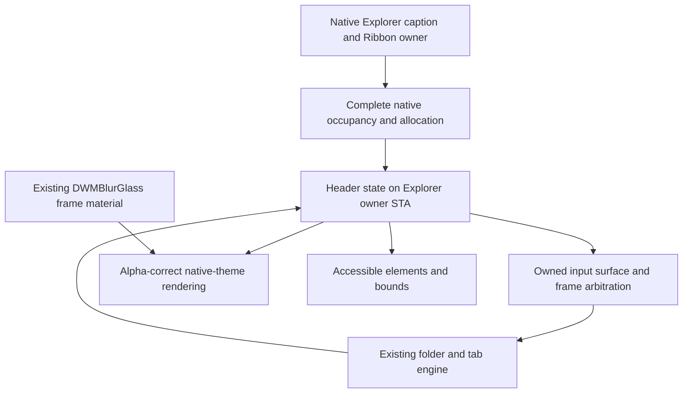
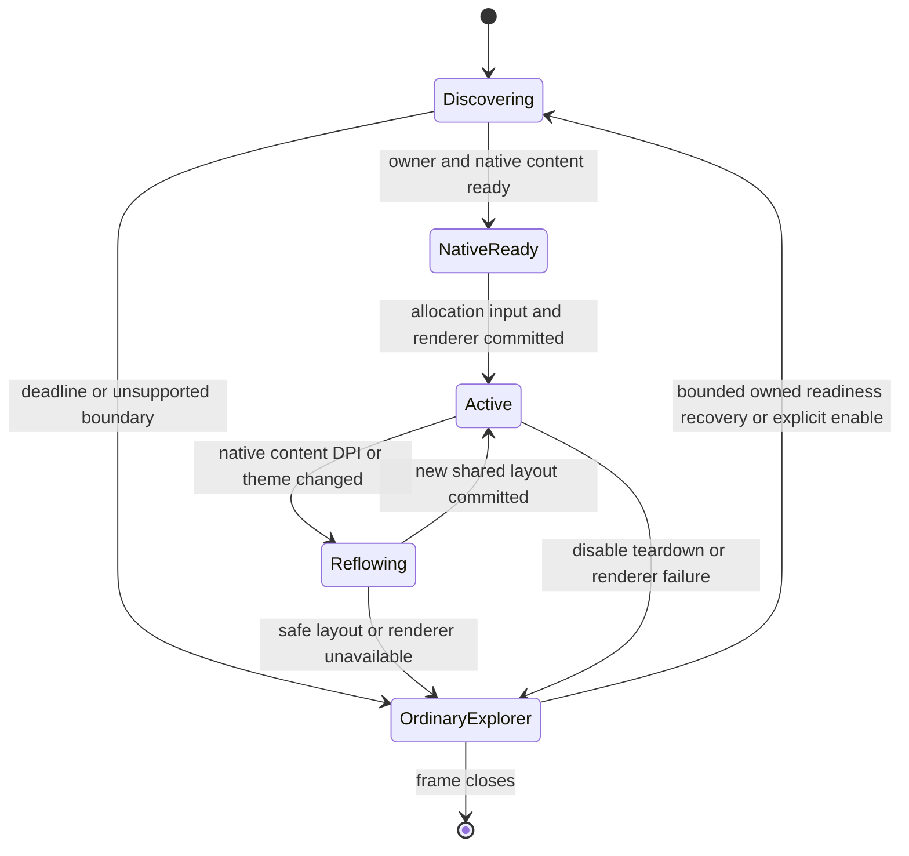
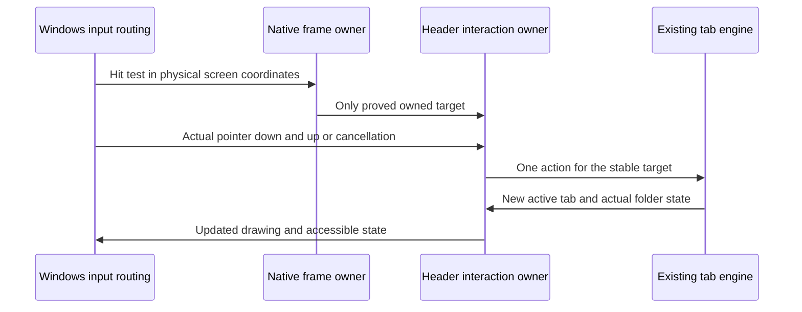

# Native Explorer Header Rebuild - Plan

## Goal Capsule

- **Objective:** Folder tabs respond to normal mouse and keyboard interaction and look like part of the user's actual Explorer window.
- **Means:** Replace the opaque layered strip with one native header component that owns allocation, input, composition and accessibility from a shared layout state, subject to KTD9-KTD12.
- **Authority:** The latest screenshots and request require a complete native finish, discovery of related defects, a thorough plan and implementation without routine clarification. R1-R14 retain their original product meaning; R15-R24 make the newly observed input, glass and contextual-header failures explicit.
- **Execution profile:** One combined local update, with proof-first header units followed by reviewed, hash-bound delivery. Preserve the current shared working tree. No public publication is requested. The executor owns implementation, review, packaging, installation and the acceptance record.
- **Stop conditions:** A missing mouse action, covered native content, flat caption pretending to be glass, wrong-window input, lost state or incomplete cleanup blocks installation of the rebuilt header. Technical proof failure returns to native-boundary investigation; it does not authorize another opaque caption fallback.

---

## Product Contract

### Summary

Rebuild the Explorer tab header as an integrated native control. Its real mouse targets, rendering and accessible elements will share the same geometry and ownership rules. Caption tabs will retain the existing DWMBlurGlass material, and crowded or unprovable caption layouts will use the already-approved native allocated row. The real Explorer navigation engine and the working snap receiver remain in place.

### Problem Frame

The installed tabs can be operated by keyboard while their mouse controls do not function. The first screenshot shows an opaque custom surface against the native glass caption. The second shows native contextual header content losing space around the custom tabs. These failures make normal folder navigation unreliable and the extension visibly foreign.

The current source creates a layered child at constant alpha 255 and paints its entire surface with a compatible bitmap and fixed colors. Keyboard commands enter through a separate thread hook, while mouse commands depend on client messages reaching that child. No frame/child hit-test ownership is established. The layout inspector discards non-action accessibility roles, so a zero-command-collision result does not preserve contextual labels, colored bands or native caption text. Existing acceptance clicked the original Navigation pane command, not a custom tab target. These are confirmed source gaps; the exact recipient of the failed physical clicks still needs the U10 observation.

### Requirements

**Preserved Explorer and delivery contracts**

| ID | Outcome |
|---|---|
| R1 | Keep the real Explorer window, Ribbon, address bar, folder views and file operations. |
| R2 | Tabs use allocated header space and never cover, clip or intercept existing controls. |
| R3 | Preserve actual Quick Access Toolbar commands, order, checked states and later customisations, including Navigation pane. |
| R4 | Share one header row when it fits; otherwise add one integrated row and retain tab overflow. |
| R5 | Match Windows theme, fonts, DPI, inactive/focus states, caption buttons, dragging, resizing, system menu and accessibility. |
| R6 | Retire only changes demonstrably owned by earlier project installations; preserve independent extensions and later user edits. |
| R7 | Keep the no-tray, real-Explorer product; introduce no floating header or replacement browser. |
| R8 | Provide bounded build compatibility, reversible installation and truthful recovery without forced Explorer termination. |

**Preserved snapping contracts**

| ID | Outcome |
|---|---|
| R9 | Keep side/corner progression and no-centering/no-minimizing behavior; Up from either top corner maximizes. |
| R10 | Complementary side-snapped windows retain Windows' actual shared-divider resize. |
| R11 | Remember an intentional shared-divider adjustment per display and reuse it for later halves and corners, including receiver restart. |
| R12 | Derive complementary sides from one boundary, without a rounding gap. |
| R13 | Preserve appropriate behavior across app minimum sizes, odd/negative work areas, DPI, taskbar and monitor changes without replacing a saved preference with a clamp. |
| R14 | Deferred native commands remain bound to their original window; cancellation or restrictions never redirect input to another app. |

**Complete native header behavior**

| ID | Outcome |
|---|---|
| R15 | Enabled mouse tab selection, close, new tab, overflow and existing tab-menu actions perform the same intended operation as their keyboard counterparts exactly once. |
| R16 | Painted targets and delivered pointer actions agree through client/nonclient hit testing, signed coordinates and DPI conversion. |
| R17 | The tab strip uses its native host region's material; caption content preserves the user's actual DWMBlurGlass backdrop rather than a solid panel or simulated blur. |
| R18 | Preserve native caption ownership and title meaning, while keeping all contextual groups and colored bands visible and usable as their content changes. A proved native-owner integration may replace only the folder-title visual; keep actual window, taskbar and accessibility titles correct and restore the native visual exactly on release. |
| R19 | Hover, press, focus, inactive, busy and disabled states remain coherent through pointer interaction, cancellation and native caption gestures. |
| R20 | Accessible names, roles, bounds, focus, selection and actions describe each real target, including independent close actions. |
| R21 | Address, search and rename editors retain their normal editing keys and context-menu behavior. |
| R22 | Cold creation, navigation, theme/DPI changes, minimize/restore, renderer loss and disable/re-enable leave a usable, stable header or restore ordinary Explorer. |
| R23 | Header changes preserve current tab state, native Ribbon collapse preference and user customisation through update, failure and removal. |
| R24 | Acceptance verifies actual mouse delivery, resulting Explorer state and live material against the exact delivered binaries; geometry and API success alone cannot pass. |

Product Contract preservation: R1-R14 retain the origin's outcomes. The latest request clarifies R2-R5 through R15-R24. The old header implementation units are superseded by U10-U15 below; the origin's snapping decisions and acceptance examples remain regression constraints.

### Key Decisions

- **Real native controls remain authoritative.** Governs R1-R5, R18. (session-settled: user-directed — chosen over a fixed row that hides native controls: the original commands must remain usable in a crowded header.)
- **Use Windows' shared divider.** Governs R9-R14. (session-settled: user-directed — chosen over a custom linked-window divider: the requested behavior is the Windows feature.)
- **Preserve the current caption material.** Governs R5, R17. The user's blur provider is part of the observed environment, not a request for a new global blur product.

### Acceptance Examples

- AE8. With two distinct real folders, click each tab and observe the actual folder view, selection/history and active accessible item change together. Covers R1, R15-R16, R20.
- AE9. Press and release new-tab, active/background close and overflow targets. Each intended operation occurs once; pressing a close target and releasing elsewhere does nothing. Covers R15-R16, R19.
- AE10. Move contrasting content behind an Explorer caption with the user's blur provider active. Exposed tab-header background follows the same live blur and tint as adjacent native caption pixels while text and glyphs stay readable. Covers R5, R17.
- AE11. Activate Drive Tools and other contextual groups, then customize and overflow the QAT while narrowing and widening the window. Native labels, colored bands, commands and address bar remain intact. Covers R2-R5, R18.
- AE12. Drag blank caption space, resize its borders, double-click to maximize, open its system menu and use caption buttons. Tab controls remain distinct from those native actions. Covers R5, R16, R19.
- AE13. Focus a close or new-tab element through accessibility without invoking it, then activate it explicitly. Use Apps/Shift+F10 with the mouse elsewhere and get a menu beside the focused tab. Covers R19-R21.
- AE14. While typing in search, the address bar and rename editors, Backspace edits text. In the actual folder view, existing history shortcuts still work. Covers R1, R21.
- AE15. Open a cold Explorer frame, temporarily withhold header/renderer readiness, then restore it. Tabs become usable within the bounded startup lifecycle; a persistent failure or disable leaves no invisible input surface, native hook or lost saved session. Covers R8, R22-R24.

### Scope Boundaries

This work changes the native header presentation and interaction boundary, not the folder/session engine or snap product behavior. Existing keyboard commands, tab navigation, reorder/detach, context menus, settings, native QAT and recovery remain compatibility surfaces.

Input-driving experiments stay in Windows Sandbox. Host inspection remains read-only until the proved update is installed through the existing setup process. No Computer Use, host mouse/keyboard simulation, forced Explorer restart, compositor replacement or global theme change is authorized by this plan.

New tab groups, a zone editor, a replacement browser, an independent floating header and a general hook framework are outside this product's identity. A universal Windows 11 port and public distribution are not part of this update.

---

## Planning Contract

### Key Technical Decisions

- KTD9. **Create one shared header layout state.** A single owner supplies region allocation, material mode, stable target identities and geometry to drawing, hit testing and accessibility. This replaces independently maintained paint rectangles and inferred click regions. Implements R2, R5, R15-R20.
- KTD10. **Require complete native occupancy before caption sharing.** Capture native QAT, caption buttons, native title and contextual visual groups through a verified native-layout/semantic inspection. Missing bounds or unknown native content are not empty space. The folder-title visual slot may be reused only through a proved replacement by its native owner that preserves window/taskbar/accessibility title meaning and restores the native visual exactly; drawing over or hiding it with tabs is not allocation. Choose the existing allocated-row boundary when a safe native caption slot cannot be established. Implements R2-R5, R18.
- KTD11. **Use a non-layered owned input/composition surface.** The primary candidate is a child HWND with an owned DirectComposition target and premultiplied-alpha content. It must not take over the parent or Ribbon's composition target. A simpler buffered/theme-alpha child is acceptable only if the same live proof establishes correct inheritance. U10 fixes the renderer/surface contract before production integration. Implements R5, R7, R16-R17.
- KTD12. **Keep native frame arbitration outside owned targets.** Preserve Explorer's original frame/DWM processing for caption buttons, resize borders and native content. Route only proved owned tab targets into the client interaction path. Do not paste an app-owned custom-frame sample over Explorer's existing WndProc. Implements R2-R3, R5, R16, R19.
- KTD13. **Model pointer actions with stable identity and cancellation.** Press, drag, capture loss, cancel, release and modal-menu results resolve against the same stable target. Save an intended up action before intentional capture release, so capture-changed cleanup cannot cancel every click. Focus and accessibility selection are separate from invocation. Existing navigation serialization exposes a coherent unavailable state rather than an enabled-looking target that silently ignores input. Implements R15-R16, R19-R21.
- KTD14. **Keep controller and renderer lifetimes on the owning STA.** Reuse the existing staged attachment, per-owner event hooks and bounded readiness policy. Coalesce native layout/theme events into owned updates. Release composition, input, accessibility and native allocation together, including failure and device loss. Implements R8, R22-R23.
- KTD15. **Make physical-path acceptance the delivery gate.** Extend the real Explorer guest harness with actual input and independent resulting-state checks. Bind material and interaction reports to component/provider hashes and document the reported guest base build. Implements R24.

### Architecture and Ownership

### Proof Gates and Alternatives

U10 must establish the combined input, native-occupancy and material contract on the actual Explorer surface. Removing `WS_EX_LAYERED` alone is not acceptance. The primary KTD11 candidate is selected because Microsoft supports an application-owned child composition target while keeping HWND hit testing distinct from visual alpha. The simple buffered path can displace it only through equivalent evidence, not a still image that looks plausible.

If neither child path inherits the actual caption backdrop safely, investigate typed native Ribbon surface ownership before continuing. Existing PDB candidates include `NetUI::HWNDHost::Create`, `OfficeCaption::_SelfLayoutDoLayout`, `TabGroup::GetGroupOffset` and `OfficeSpaceUpperRibbonLayout::OnListenedAdjustLayout`; their names do not establish construction or insertion contracts. Existing exact-image compatibility guards remain mandatory for private boundaries.

Replacing Explorer's compiled Ribbon markup is rejected: the documented framework contract does not append arbitrary controls to a running Ribbon without rebuilding its framework/command ownership. Keeping the constant-opacity layered strip, forwarding clicks around it, snapshotting a background, applying a new global blur or masking native content cannot satisfy R2, R16-R18.

[ShellTabs](https://github.com/shefben/shelltabs) is current prior art for an Explorer-owned non-layered deskband and native theme drawing. Its actual toolbar integration does not prove caption ownership or this user's glass compatibility. The bounded source audit found no confirmed reuse grant, so its code is design evidence rather than a copy source. The existing folder engine and delivery machinery remain the base.

### Dependencies and Implementation-Time Questions

The host runs DWMBlurGlass 2.3.1.0 through `DWMBlurGlass_Extend`, using `<DWMBlurGlass folder>\DWMBlurGlass.exe` and `data\config.ini`. Capture its exact executable, extension, configuration and `data\symbols` cache identity read-only, then reproduce the provider in the guest. Its current blur amount is 44, with effect type 2 and method 0. The provider's `runhost` route requires an elevated guest token; stage it outside the guest profile and use its existing lifecycle. No host settings are changed to simplify testing.

The existing guest reports base build 19041 while the relevant Explorer/Ribbon components match the 19045 host. Extend this identity check to the DWM components and provider dependencies needed by the material proof. A stock-guest alpha test does not establish DWMBlurGlass compatibility. Any attach-time version-query adaptation stays lab-only and remains disclosed.

Resolve during U10: the actual failed-click recipient, the safe caption occupancy/insertion boundary, and which alpha surface inherits the provider's backdrop. These are implementation observations with explicit probes and failure gates, not user product questions. Their outcome fixes the native surface contract before U11-U14 depend on it.

### Assumptions

- The requested blur means preserving the real caption material already configured on this PC. An allocated client row follows its actual native toolbar material rather than inventing glass in an otherwise opaque region.
- Conventional tab interactions use the existing engine's semantics, including its last-tab, reopen, duplicate, reorder and detach behavior. The work repairs their native input and presentation rather than adding a different tab product.
- Supported guest configuration changes can cover representative DPI/theme states; physical multi-monitor moves and touchpad gestures are reported separately when the available guest cannot reproduce them.

### Sequencing and System-Wide Impact

U10 creates the diagnostic acceptance seam and commits the native surface contract. U11 owns the shared layout state consumed by U12 and U13. U14 integrates lifecycle/accessibility with those owners. U15 consumes only a passing combined implementation. Execute the shared `ExplorerTabs.cpp` changes serially in the existing dirty checkout, preserving the unrelated work.

The new surface participates in Explorer's STA, COM accessibility, drag/drop and DWM lifetimes. It must not introduce process-wide input hooks, hold native layout locks across external callbacks, leave a target over another app, or reset user Ribbon state during reflow. Any resource-sharing choice must retain owner-thread cleanup and avoid per-frame polling when native events suffice.

---

## Implementation Units

### U10. Establish the actual native header contract

**Goal:** Reproduce the missed failures and prove a single safe surface/allocation/input combination before replacing production code.

**Requirements:** R2-R5, R8, R15-R18, R24; AE8-AE12. **Dependencies:** existing installation/recovery evidence and matching guest.

**Files:** `native/HeaderLab.cpp`, `native/ExplorerHeaderProbe.cpp`, `native/HeaderCommands.h`, `sandbox/Invoke-LabRequest.ps1`, `Start-NativeTestSandbox.ps1`; proposed `native/HeaderInteractionTests.cpp` and `native/HeaderMaterialProbe.cpp`; `native/CMakeLists.txt`.

**Approach:** Use KTD10-KTD12 and KTD15 to capture the baseline's actual target routing, complete native occupancy and user-provider material. Keep experimental renderers in the guest harness. Select and record the surface contract only after all three proofs agree; failure returns to native-owner research.

**Execution note:** Start with actual input that fails on the installed mechanism. Existing direct engine calls and action-only geometry checks remain useful lower-level tests but cannot stand in for this seam.

**Test scenarios:**

- Covers AE8-AE9. Click bodies, close, plus and overflow on two distinct folders; record actual receiving HWND, client/nonclient messages, capture and resulting folder/tab state.
- Covers AE10. Compare changing content behind the actual glass caption with adjacent untouched native pixels under the exact provider/configuration.
- Covers AE11. Enter Drive Tools, Picture Tools and Search Tools states and capture their native visual/semantic occupancy, including labels and colored groups.
- If reusing the folder-title visual slot, prove that its native owner performs the replacement, window/taskbar/accessibility titles remain correct and the native visual restores exactly after release or failure. Contextual content remains protected.
- Covers AE12. Probe native caption buttons, edges, blank drag space and QAT alongside owned targets; native routing must retain priority.
- Missing native bounds, unavailable capture or an unsupported compositor cannot produce a passing integration result.

**Verification:** A source-bound contract dossier names the proved surface, native owner, target route, material mode, any folder-title visual replacement/restoration contract, cleanup and unresolved limits. `HeaderInteractionTests.cpp` catches real routing/state failures; `HeaderMaterialProbe.cpp` catches visual material failure. Neither pure geometry nor an accessibility default action proves these outcomes.

### U11. Replace inferred offsets with native allocation and shared geometry

**Goal:** Allocate header space from complete native content and expose one authoritative layout to all consumers.

**Requirements:** R2-R5, R16, R18, R22-R23; AE1-AE2, AE11-AE12. **Dependencies:** U10's proved allocation boundary.

**Files:** `native/HeaderIntegration.cpp`, `native/HeaderIntegration.h`, `native/HeaderCommands.h`, `native/ExplorerTabs.cpp`, `native/ExplorerHeaderProbe.cpp`; proposed `native/HeaderLayout.h`, `native/HeaderLayout.cpp`, `native/HeaderLayoutTests.cpp`; `Test-HeaderIntegration.ps1`, `native/CMakeLists.txt`.

**Approach:** Implement KTD9-KTD10. Preserve native title meaning, contextual content, QAT and caption controls. Reuse the folder-title visual slot only under U10's proved native-owner replacement and restoration contract. Coalesce content/layout invalidation and reserve/release an actual row when no safe caption slot exists. Convert coordinates once at defined boundaries, and use the same layout for drawing, hit testing and accessibility.

**Test scenarios:**

- Covers AE11. Activate each contextual band while tabs are active, customize QAT, collapse/expand Ribbon and cross the narrow/wide threshold without overlap or accumulated offsets.
- One/many/long tabs preserve an active visible target and reachable overflow after layout changes.
- Negative screen origins and representative 100-200% scale produce consistent painted, hit and accessible bounds, including right/bottom edges.
- Covers AE2. Disable after later user toolbar edits; restore native allocation and collapse state without reverting those edits.
- Unknown or incomplete native occupancy chooses the safe allocated row or restores ordinary Explorer rather than treating the area as free.

**Verification:** Pure layout tests cover arithmetic and region arbitration but not native ownership. The complete native-content probe and U10's real input/visual seam must also pass on each layout mode.

### U12. Render the header through the proved native composition surface

**Goal:** Match the host region's real material, text and interactive states without an opaque caption patch.

**Requirements:** R5, R7, R17, R19, R22; AE10. **Dependencies:** U10's renderer contract and U11.

**Files:** `native/ExplorerTabs.cpp`; proposed `native/TabHeaderHost.h`, `native/TabHeaderHost.cpp`, `native/TabHeaderRenderer.h`, `native/TabHeaderRenderer.cpp`; `native/HeaderMaterialProbe.cpp`, `native/HeaderInteractionTests.cpp`, `native/CMakeLists.txt`.

**Approach:** Implement KTD11 on the owned child surface. Reuse native theme fonts/colors/metrics and explicit premultiplied alpha for glyphs, icons and state fills. The frame remains the backdrop owner. Remove the constant-alpha layered-child path and its full fixed-color bitmap fill after the replacement passes.

**Test scenarios:**

- Covers AE10. Caption background follows live native blur/tint through active/inactive and restored/maximized states; an allocated row follows its actual native toolbar material.
- Selected, hover, pressed, focus and disabled states stay legible over bright/dark backgrounds; icons and text have no black halo or disappearing alpha.
- High contrast and transparency/provider-disabled states follow the native host material and remain usable without changing system settings.
- Renderer creation/device loss and theme/DPI changes recreate owned resources or release the header safely; no invisible input surface remains.

**Verification:** Material evidence and resource-lifecycle results identify the exact backend, provider and binaries. A visible frame or successful graphics API call alone is insufficient.

### U13. Make pointer, keyboard and native frame actions agree

**Goal:** Every displayed target performs its action reliably while Explorer retains native caption and editor behavior.

**Requirements:** R1-R3, R5, R15-R16, R19, R21; AE8-AE9, AE12, AE14. **Dependencies:** U11-U12.

**Files:** `native/ExplorerTabs.cpp`, `native/TabHeaderHost.cpp`, `native/HeaderLayout.h`, `native/HeaderInteractionTests.cpp`.

**Approach:** Implement KTD12-KTD13 using the existing tab engine. Keep stable target identity through press/cancel/release and drag operations. Restrict history interception to the real folder-view focus path, preserve editors, and anchor keyboard menus to their focused target.

**Test scenarios:**

- Covers AE8-AE9. Real mouse switching between distinct folders, active/background close, middle-close, plus and overflow changes real Explorer state exactly once.
- Drag off a pressed control, lose capture, deactivate, cancel or remove its target before release; no stale action fires. Intentional release still invokes the original action.
- A tab changes order or closes while a menu is open; the selected menu action resolves to the original stable target or cancels. Busy navigation preserves the existing serialization and exposes its unavailable controls consistently.
- Reorder/detach and cross-window drops preserve the existing model and cancel safely with Escape.
- Covers AE12. Blank caption drag, double-click maximize, system menu, caption buttons, borders and native QAT retain their native behavior.
- Covers AE14. Backspace, selection and text navigation work in address, search and rename editors while folder-view history shortcuts remain intact.

**Verification:** Actual input recipients, action counts, active stable tab identity and real folder state agree. This seam catches routing and state errors that direct model invocation misses.

### U14. Finish accessible state and owner-thread lifecycle

**Goal:** Input, accessible elements and native resources remain consistent across normal lifecycle and failure.

**Requirements:** R5, R8, R19-R24; AE13-AE15. **Dependencies:** U11-U13.

**Files:** `native/ExplorerTabs.cpp`, `native/ExplorerMvpHost.cpp`, `native/TabHeaderHost.cpp`, `native/TabHeaderRenderer.cpp`, `native/HeaderIntegration.cpp`, `native/HeaderInteractionTests.cpp`, `native/HeaderLab.cpp`.

**Approach:** Implement KTD13-KTD14. Expose independent close/new/overflow actions and accurate selection/focus without invocation. Reuse bounded startup and owner-STA teardown while treating allocation, renderer, input, drag/drop and accessibility as one committed lifetime.

**Test scenarios:**

- Covers AE13. Accessibility focus does not invoke new/close; selection flags, names, roles, shortcuts, bounds, offscreen state and explicit actions describe the actual target.
- Keyboard context menus stay anchored to the focused tab when the pointer is elsewhere.
- Covers AE15. Cold native frame creation, temporary readiness rejection, persistent failure, disable during recovery and frame close leave no orphaned hooks or lost saved session.
- Two owner STAs disable in either order and release only their own event/composition/input resources.
- Minimize/restore, layout invalidation and metadata completion cannot retain stale pressed/focused targets or resurrect a disabled surface.

**Verification:** Guest interaction and lifecycle reports prove cleanup and resulting state, including renderer failure. Existing session/configuration tests continue passing.

### U15. Verify, review and install the complete native update

**Goal:** Deliver only the combined result that meets the strengthened acceptance contract.

**Requirements:** R1-R24; AE1-AE15. **Dependencies:** U10-U14.

**Files:** `Test-Mvp.ps1`, `Test-HeaderIntegration.ps1`, `Build-Mvp.ps1`, `sandbox/Invoke-LabRequest.ps1`, `MVP-README.md`, `MVP-STATUS.md`, `docs/header-acceptance.md`, `native/HeaderInteractionTests.cpp`, `native/HeaderMaterialProbe.cpp`; existing `native/SnapIntegrationTests.cpp` as a regression consumer.

**Approach:** Apply KTD15, remove abandoned experiments, review the exact source and package the corresponding native binaries. Preserve the existing immutable installation/recovery mechanism. Keep the current desktop unchanged until the combined native proofs pass.

**Test scenarios:**

- Run the existing model/configuration/setup suite and real shared-divider/saved-split/maximize/cancellation suite with the delivered binaries, including fast side changes without an intermediate floating position.
- Repeat tab input, material and complete-native-content scenarios across cold frames, multiple windows, contextual modes and representative theme/DPI states available in the guest.
- Update from the current payload, independently disable/re-enable tabs and snapping, and exercise failure rollback/in-use cleanup without forced Explorer termination.
- Verify installed hashes, loaded header ownership, preserved settings/Ribbon state, native gesture readiness and startup/Start-menu registrations with read-only host checks.

**Verification:** The final record separates geometry, actual mouse behavior, accessibility, material, lifecycle and installation results. It reports unavailable hardware/provider cases accurately and never promotes them to passes.

---

## Verification Contract

Use the existing CMake release build, `Test-Native.ps1`, `Test-Mvp.ps1` and `Test-HeaderIntegration.ps1` as the base. Extend the guest dispatcher with the U10 interaction/material cases and retain red baseline evidence before implementation. `native/HeaderLayoutTests.cpp` proves pure geometry; `native/HeaderInteractionTests.cpp` proves delivered input and real Explorer state; `native/HeaderMaterialProbe.cpp` proves the live backdrop against the actual provider. Each feature-bearing unit names its test seam and its limits.

Record binary/source/provider hashes, Windows and DWM versions, reported guest build, display/work-area/DPI, theme/material mode, target identity, input path, actual receiving window, capture transitions, native occupied regions and resulting folder/tab state. Every native-content inspection must state its coverage; missing/unknown bounds, capture or input observations fail their corresponding gate.

Compare live material across changing background content and an untouched native caption reference, with glyph regions identified separately. Review the resulting images as well as the measured report. A solid matching average color, pixel-offset-only arrangement, alpha flag or still screenshot is not proof of native blur.

Keep the previously passing native snapping contract under regression rather than changing it to accommodate the header. Physical touchpad timing, unavailable physical mixed-DPI/multi-monitor transitions and clean-second-PC distribution remain separate claims.

---

## Definition of Done

The strengthened requirements and acceptance examples pass against the same reviewed source, release binaries and installed update. Real mouse controls, actual folder navigation, native caption behavior, complete contextual content, accessible state and the configured backdrop agree in both caption and allocated layouts. Failure and disable restore current native state without losing user data or leaving invisible input resources. The existing native snapping and remembered divider behavior remain intact.

The delivery includes the proof records, recovery identity and explicit support limits. Experimental or abandoned mechanisms are removed from production, and a failed or unmeasured required input/material/ownership gate leaves the rebuilt header undeployed.

---

## Sources and Research

- Origin product/acceptance contract: `docs/plans/2026-11-03-2005-fix-native-headers-snapping-plan.md`.
- Current source and test audit: `evidence/header-rebuild-20261104/input-audit.md` and `native-render-audit.md`.
- Flow gaps and defaults: `evidence/header-rebuild-20261104/spec-flow.md`.
- Installed user/provider baseline: `evidence/header-rebuild-20261104/installed-baseline.json` and the read-only provider configuration recorded by the executor.
- Native layout ownership/PDB research: `evidence/header-symbols-20261104-120953/findings.md`; symbols are candidate research seeds, not proof of a supported insertion contract.
- [Microsoft layered-child click-through report](https://learn.microsoft.com/en-us/answers/questions/1096479/how-to-stop-ws-ex-layered-causing-mouse-clicks-to), [custom-frame guidance](https://learn.microsoft.com/en-us/windows/win32/dwm/customframe), [DirectComposition child targets](https://learn.microsoft.com/en-us/windows/win32/api/dcomp/nf-dcomp-idcompositiondevice-createtargetforhwnd), and [composition-engine alpha/input separation](https://learn.microsoft.com/en-us/archive/msdn-magazine/2014/june/windows-with-c-high-performance-window-layering-using-the-windows-composition-engine) shape KTD11-KTD13.
- [DWMBlurGlass](https://github.com/Maplespe/DWMBlurGlass) defines the existing provider dependency. [DrawThemeParentBackground](https://learn.microsoft.com/en-us/windows/win32/api/uxtheme/nf-uxtheme-drawthemeparentbackground) and [DwmEnableBlurBehindWindow](https://learn.microsoft.com/en-us/windows/win32/api/dwmapi/nf-dwmapi-dwmenableblurbehindwindow) do not by themselves establish child caption-backdrop inheritance.
